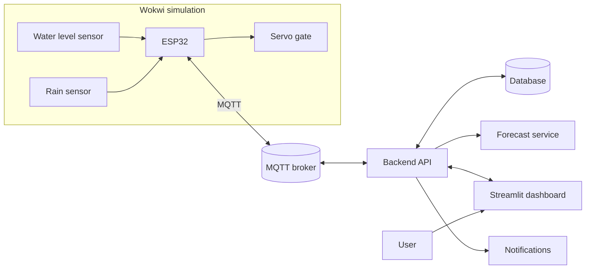

# NgậpSense — IoT Water Level Monitoring & Flood Warning System

> **Course project.** A prototype built on a simulated ESP32 and deployed to a cloud server.
> It does not connect to real drainage infrastructure.

---

## 1. Overview

**NgậpSense** (from Vietnamese *ngập* — flooding — and *sense*) collects **water level** and **rainfall**
data from sensors, publishes it over **MQTT**, stores it in a database, and displays live and historical
readings on a web dashboard. When readings cross configured thresholds, the system raises alerts on the
dashboard and sends a remote notification. Two extensions are included: a **short-term water level forecast**
and a **servo-driven gate** that models a sluice gate controlled from the dashboard.

The ESP32 and its sensors run in the **Wokwi simulator**, so the system can be demonstrated without hardware.

## 2. Objectives

- Collect water level and rainfall readings and publish them via MQTT.
- Store time-series data and visualize current and historical values.
- Raise alerts against configurable thresholds and notify remotely.
- Forecast water level for a short horizon from past readings.
- Send control commands from the dashboard to the virtual gate.

## 3. Scope

| In scope | Out of scope |
| --- | --- |
| IoT architecture on a simulated test model | City-wide flood forecasting |
| Monitoring, storage, alerting, short-term forecasting | Control of real drainage infrastructure |
| Servo gate simulation for decision support | Integration with municipal SCADA systems |

## 4. Architecture



- **Monitoring:** `Sensor → ESP32 → MQTT broker → Backend → Database → Dashboard`
- **Control:** `Dashboard → Backend → MQTT broker → ESP32 → Servo`
- Stored readings feed the forecast service; predictions are shown alongside live measurements.

## 5. Components

| Layer | Technology | Role |
| --- | --- | --- |
| Edge | ESP32, potentiometer (level), rain sensor, servo — Wokwi | Measure and publish data; receive commands |
| Transport | HiveMQ Cloud (or local Mosquitto) | Message relay between device and server |
| Backend | FastAPI, paho-mqtt, SQLAlchemy | Process and store data, evaluate thresholds, issue commands |
| Database | SQLite locally, managed Postgres in production | Time-series storage |
| Analytics | scikit-learn | Short-horizon water level forecast |
| Dashboard | Streamlit, Plotly | Live view, history, alerts, controls |
| Hosting | Render (two Python web services) | Public deployment of backend and dashboard |

## 6. Functional Requirements & Progress

**Status:** ✅ Done · 🚧 In progress · ⬜ Not started · 🔶 Extension

| ID | Feature | Description | Priority | Status |
| --- | --- | --- | --- | --- |
| FR01 | Water level monitoring | Read level via sensor and ESP32, publish over MQTT | Core | ⬜ |
| FR02 | Rainfall tracking | Read rain sensor, process and publish measurements | Core | ⬜ |
| FR03 | Data display | Show current level, rainfall, and system status | Core | ⬜ |
| FR04 | Data storage | Persist time-series readings in the database | Core | ⬜ |
| FR05 | Historical visualization | Query and chart readings over a selected time range | Core | ⬜ |
| FR06 | Flood risk alert | Compare level with thresholds; alert on dashboard and/or device | Core | ⬜ |
| FR07 | Remote notification | Email or push message when an alert condition is met | Core | ⬜ |
| FR08 | Water level forecast | Short-horizon forecast from historical data | Extension | 🔶 |
| FR09 | Drainage control support | Send MQTT commands to open/close the simulated gate | Extension | 🔶 |
| FR10 | Device status monitoring | Show connection and health status of main components | Optional | ⬜ |
| FR11 | Access management | Register, log in, authenticate protected actions | Optional | ⬜ |
| FR12 | System information query | Look up current level, history, and alert state | Optional | ⬜ |

**Overall progress:** `0%` — _updated after each milestone._

FR01–FR07 are the core monitoring and alerting scope; FR08–FR09 are extensions; FR10–FR12 depend on time.

## 7. Target Specifications

| Item | Target |
| --- | --- |
| Sampling interval | 5–10 s (configurable) |
| Update latency | ≤ 3 s from simulator to dashboard |
| Alert thresholds | 0.3 m watch, 0.5 m warning, 0.8 m danger |
| Retention | At least 30 days of readings |
| Forecast horizon | 15–60 min, evaluated with MAE/RMSE |
| Connectivity loss | Device auto-reconnects to the broker |
| Health reporting | Sensor health published every 30 s and after reconnect |

## 8. MQTT Topics

| Topic | Direction | Payload |
| --- | --- | --- |
| `ngapsense/{device_id}/telemetry` | Device → Server | `{ "ts", "water_level", "rain_mm", "rain_rate", "rssi" }` |
| `ngapsense/{device_id}/status` | Device → Server | `{ "device_id", "online", "fw", "uptime_ms", "rssi", "sensors": { "water_level", "rain" } }` |
| `ngapsense/{device_id}/alert` | Device → Server | `{ "level", "value" }` |
| `ngapsense/{device_id}/cmd` | Server → Device | `{ "action": "open" \| "close", "gate_id" }` |
| `ngapsense/{device_id}/cmd/ack` | Device → Server | `{ "action", "result" }` |

QoS: telemetry `0/1`, commands `1`, status `1` with a last-will message.

### Sensor health

The device publishes one health status per sensor on the retained `status` topic immediately after it
connects and then every 30 s. The status is inferred from the evidence available on the ESP32:

- **Read errors** — no echo, or an HC-SR04 distance outside the 2–400 cm range.
- **Repeated failures** — three consecutive failed water level reads.
- **Stale data** — no valid water level reading for 15 s.

| Status | Meaning |
| --- | --- |
| `HEALTHY` | Recent readings pass the read and range checks |
| `DEGRADED` | A few read errors, or no reading yet |
| `ERROR` | Repeated read failures, stale data, or a stuck rain contact |

`OFFLINE` is separate from these states: the MQTT last-will message marks the whole device offline when
it disconnects. Rain is `ERROR` only when its reed switch stays closed for 5 min, since a normal tip is
momentary.

```json
{
  "device_id": "esp32-01-7f3a9c",
  "online": true,
  "fw": "0.1.0",
  "uptime_ms": 120000,
  "rssi": -55,
  "sensors": {
    "water_level": "HEALTHY",
    "rain": "HEALTHY"
  }
}
```

## 9. Repository Layout

```
ngapsense/
├── sim/                  # Wokwi project: sketch.ino, diagram.json, libraries.txt, wokwi.toml
├── backend/              # FastAPI app: api/, mqtt/, db/, services/, tests/
├── frontend/             # Streamlit app: app.py, pages/, ui/, services/
├── ml/                   # notebooks/ and src/ for model training and evaluation
├── docs/                 # architecture, mqtt-topics, api, wiring, report/
├── scripts/              # dev.ps1, reset-db.ps1
├── .env.example
└── README.md
```

## 10. Running Locally

Prerequisites: Python 3.11+, a MQTT broker (HiveMQ Cloud cluster or local Mosquitto), and the Wokwi
extension or a wokwi.com account.

```powershell
Copy-Item .env.example .env      # broker host, credentials, DB URL, thresholds

python -m venv .venv; .venv\Scripts\Activate.ps1
pip install -r backend\requirements.txt -r frontend\requirements.txt

uvicorn app.main:app --reload --app-dir backend --port 8000    # terminal 1
streamlit run frontend\app.py --server.port 8501               # terminal 2
```

Open `sim/diagram.json` and `sim/sketch.ino` in Wokwi and start the simulation. The dashboard should
update every second and the gate control should move the servo.

## 11. Deployment (Render)

Two services are deployed from the same repository:

| Service | Type | Start command |
| --- | --- | --- |
| `ngapsense-api` | Web service (Python) | `uvicorn app.main:app --host 0.0.0.0 --port $PORT --app-dir backend` |
| `ngapsense-dashboard` | Web service (Python) | `streamlit run frontend/app.py --server.port $PORT --server.address 0.0.0.0` |

Configuration:

- Environment variables (`MQTT_HOST`, `MQTT_USERNAME`, `MQTT_PASSWORD`, `DATABASE_URL`, `API_BASE_URL`,
  `ALERT_THRESHOLDS`) are set in the Render dashboard.
- Production uses a managed Postgres instance; SQLite is only for local development.
- The dashboard reads the backend URL from `API_BASE_URL`, so point it at the deployed API service.
- The MQTT client runs inside the API process and connects outbound to HiveMQ Cloud.
- Wokwi connects to the same broker, so the simulator works against the deployed server.

## 12. Roadmap

| Phase | Work | Deliverable |
| --- | --- | --- |
| M1 | Broker setup, Wokwi diagram, pin map | Working simulation |
| M2 | Sketch: sensor reads and MQTT publish | Telemetry stream |
| M3 | Backend, database, dashboard | FR01–FR05 |
| M4 | Threshold alerts and notifications | FR06–FR07 |
| M5 | Gate control and device status | FR09–FR10 |
| M6 | Forecast model and evaluation | FR08, results |
| M7 | Deploy, test, demo, report | Final submission |

## 13. Limitations

- Simulated sensing: readings come from virtual inputs, so real sensor error is not measured.
- Free hosting tiers sleep when idle, which drops the MQTT connection until the next request.
- Forecasts are indicative only and not suitable for operational use.
- Gate control is a demonstration of the decision loop, not real actuation.
- Login state does not persist across page reloads in the dashboard.
